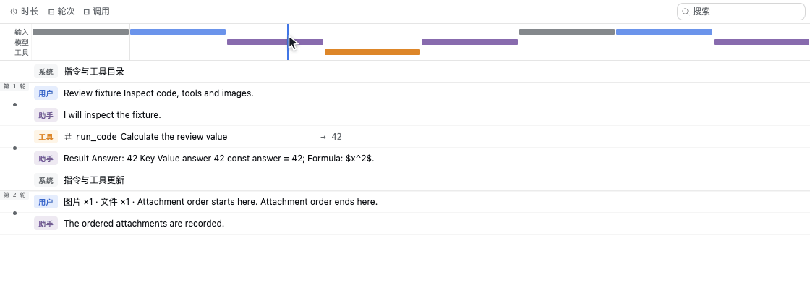

<div align="center">

# Codex Trace

[](https://github.com/xz1220/dsh-trace-plugin/actions/workflows/ci.yml)
[](https://www.npmjs.com/package/dsh-trace-extension)
[](LICENSE)
[](#requirements)

**When an agent stalls or surprises you, inspect what it received and which tools it called.**

Bring the DeepSeek Harness (DSH) timeline, execution ledger, and detail inspector into the Codex conversation sidebar.

[简体中文](README.zh-CN.md) · [Quick start](#quick-start) · [How it works](#how-it-works) · [What you can inspect](#what-you-can-inspect) · [FAQ](#faq) · [Documentation](#documentation)

</div>

```sh
npx dsh-trace-extension setup
```



## Quick start

### Requirements

- **macOS / Codex**: a client with local plugins, MCP Apps, and official `rollout-trace` recording support.
- **Node.js** and npm/npx to run the setup helper.
- **Python** available as `python3`, and a **Codex CLI** on PATH with plugin commands. The Python reader needs no additional Python packages.

See the [installer guide](docs/INSTALLER.md#quick-start) for detailed environment requirements.

### 1. Install

Open a terminal in a trusted directory outside the checkout and run:

```sh
npx dsh-trace-extension setup
```

The package includes the built plugin: no GitHub login, source checkout, or local build is required. Setup shows the files and settings it will change, then installs a stable local copy and configures recording after confirmation.

Optionally, preview the plan first with `npx dsh-trace-extension setup --dry-run`.

### 2. Reopen Codex and run a new task

Fully quit and reopen Codex, then run a new task. Recording settings must take effect **before the new Codex process starts**. Opening the viewer does not enable recording or capture earlier execution retroactively.

### 3. Open the conversation sidebar

Choose **Codex Trace** from the conversation's right-panel tools menu. The panel finds recordings for the current chat and follows new events. Use the timeline to locate steps, the ledger to follow calls, and the inspector to expand content.

See the [installer guide](docs/INSTALLER.md) for settings and troubleshooting.

## How it works

```text
Official Codex recordings → local Python reader → DSH view in the Codex sidebar
```

Codex records execution; the viewer reads official trace bundles. See the [product guide](docs/PRODUCT.md#compatibility) for supported recording formats. The viewer does not modify recordings. Installation and explicit recording-directory registration write local configuration.

The reader has no active trace upload, analytics, or remote-service integration. Native mode passes content to the local Codex host for display; optional preview uses authenticated loopback HTTP. The host controls its own handling of received data.

Recordings may contain prompts, tool output, private code, images, and credentials. Read [Security and privacy](.github/SECURITY.md) before copying, exporting, or sharing them.

## What you can inspect

Suppose you ask an agent to fix a failing test. Find the waiting period on the **timeline**, locate file reads and test runs in the **ledger**, then open the **inspector** to check arguments, results, and the context sent to the model.

| What you want to check                       | Where to look                                                                                    |
| -------------------------------------------- | ------------------------------------------------------------------------------------------------ |
| Which step is running or complete?           | Requests, nested tool calls, and results in the timeline and ledger.                             |
| What did a tool actually do?                 | Call details with arguments, results, and supported recorded images.                             |
| What did the model receive?                  | Separate views of reconstructed complete context, incremental input, and original response JSON. |
| Where did time go?                           | Available request and tool timings in the recording.                                             |
| What continued after a resume or compaction? | Existing history, fork and compaction records, and their sources.                                |

Complete context is reconstructed from available recordings. Uncaptured text or images, opaque compacted content, and missing timing remain explicitly unavailable. These records provide observable execution evidence, not a view of every internal model thought.

## FAQ

<details>
<summary><strong>What if rollout-local has a source conflict?</strong></summary>

Inspect the current source without changing it:

```sh
codex plugin marketplace list --json
```

If temporary project discovery causes the conflict, retrying from a trusted directory outside the repository may help. Changing directories does not remove persistent registrations. Setup preserves the existing source and stops; keep its registration, settings, and recordings, and follow [source-conflict troubleshooting](docs/INSTALLER.md#rollout-local-source-conflict) instead of force-deleting or overwriting them.

</details>

<details>
<summary><strong>Why is the panel empty, or some content missing?</strong></summary>

Check that recording settings took effect before Codex started and that the recording belongs to the current chat. An empty resumed recording keeps waiting. The viewer displays captured content and cannot recover missing evidence. Unsupported formats and exceeded limits produce explicit errors; event logs are limited to 256 MiB and each payload to 64 MiB.

</details>

<details>
<summary><strong>How do I check or uninstall a helper-managed installation?</strong></summary>

```sh
npx dsh-trace-extension doctor
npx dsh-trace-extension uninstall
```

doctor checks settings and files without changing them. Uninstall preserves recordings and unrelated configuration. Installed files and an open panel can differ, so reopen the client before checking the interface. See the [installer guide](docs/INSTALLER.md) for help.

</details>

## Documentation

- [Installation and troubleshooting](docs/INSTALLER.md)
- [Usage](docs/PRODUCT.md) · [How it works](docs/ARCHITECTURE.md) · [Read-only reconciliation](docs/RECONCILIATION.md)
- [Data handling and sharing](.github/SECURITY.md)
- [Project roadmap](docs/ROADMAP.md)

## Contributing

Use [GitHub Issues and PRs](.github/CONTRIBUTING.md#issues-and-proposals) for synthetic reproductions and focused improvements. Discuss larger changes first. The maintainer prioritizes work using scope and evidence, without fixed response or repair deadlines.

See [Contributing](.github/CONTRIBUTING.md) for development setup and checks, and [source installation and manual recording](.github/CONTRIBUTING.md#source-installation-and-manual-recording) for development usage. Run `npm run demo` from a source checkout for isolated synthetic recordings without reading personal Codex data.

## Attribution and license

Independently maintained; **not an official OpenAI or DeepSeek product**. The interface includes MIT-licensed components from [DeepSeek Harness](https://github.com/deepseek-ai/deepseek-harness) (DSH); see [vendor/dsh/PATCHES.md](vendor/dsh/PATCHES.md) for adaptations.

This project is [MIT licensed](LICENSE). Distributions include `LICENSE` and third-party notices.
