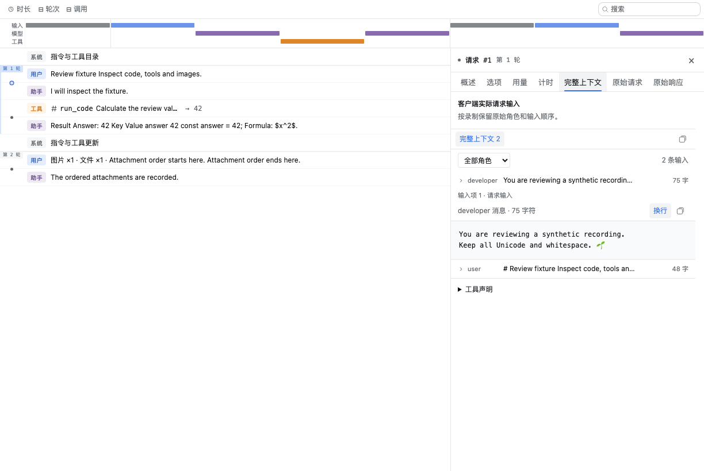

# Codex Trace

把 DSH 的轨迹观察体验带到 Codex，让 Agent 的行为和可见依据更容易理解，帮助你更好地使用 Agent。

在聊天旁查看已录制的模型请求、工具调用、上下文变化和执行耗时。当前集成范围为 **macOS / Codex**。

[English](README.md) · [安装说明](docs/INSTALLER.md) · [参与贡献](.github/CONTRIBUTING.md) · [安全与隐私](.github/SECURITY.md)



_截图来自合成数据的本地预览，不含私人聊天，也不代表原生 Codex 安装验收。_

## 能帮你看清什么

- **执行如何展开**：用 DSH 时间轴和执行列表查看请求、嵌套工具调用与返回，包括已录制的图片，支持搜索、折叠和详情查看。
- **模型收到哪些信息**：对比还原的完整上下文、实际发送的增量请求和原始响应 JSON。
- **时间花在哪里**：查看录制中可用的请求与工具耗时，定位需要进一步检查的步骤。
- **历史如何延续**：在恢复任务、分叉和压缩后查看已有历史及其来源，并持续读取当前聊天的新事件。

查看器依据官方 `rollout-trace` 录制展示信息。未录制的图片、加密压缩文本或缺失耗时会保留为缺失，无法补回过去的执行，也不保证解释模型的全部决策。

## 开始使用

需要 macOS，以及支持本地插件 / MCP Apps / 官方录制的兼容 Codex 客户端。安装时还需在 PATH 中提供支持插件命令的 `codex` CLI，并准备 `python3`（Python 3.9+）、Node.js 20.19+ 和 npm/npx。读取器支持录制 schema 1 和 2；其他系统与宿主未声明支持。

**验证范围：** 首个 npm 版本 `0.2.19` 已完成隔离环境中的安装生命周期验证；正式原生侧栏和重新登录后的录制启动顺序仍待验收。客户端兼容性取决于版本与录制格式，安装成功本身不能证明原生面板已就绪。

```sh
npx dsh-trace-extension setup
```

1. 审阅安装助手展示的文件和配置变更，再确认安装。
2. 完全退出并重新打开 Codex，让新进程取得录制配置。
3. 运行一个新任务，从聊天右侧工具菜单打开 **Codex Trace**。

包内包含已构建插件，无需 GitHub 登录、克隆仓库或本地构建。安装会准备稳定的本地副本并配置录制；清空 npm 缓存不会移除该副本。录制必须在 Codex 进程启动前开启，打开查看器不会自动开始录制。

更多安装选项与验证边界见[安装说明](docs/INSTALLER.md)。只想先查看计划可运行：

```sh
npx dsh-trace-extension setup --dry-run
```

## 检查与卸载

```sh
npx dsh-trace-extension doctor
npx dsh-trace-extension uninstall
```

doctor 检查配置和文件。重复安装会复用自身未被修改的安装；卸载保留录制和无关配置。后续跨版本升级方式将在发行前说明并验证，兼容性评估从 `0.2.19` 开始。

## 看不到内容时

**面板为空。** 检查 Codex 启动前是否已开启录制，以及录制是否属于当前聊天。已有聊天不能追溯补录；任务恢复后的空录制会继续等待新事件。

**缺少文字、图片或耗时。** 查看器只展示可用录制证据，不推测未捕获内容。格式不支持或超过读取限制时会明确报错；当前事件日志上限为 256 MiB，单个 payload 上限为 64 MiB。

**安装后仍显示旧界面。** 已安装文件和正在运行的面板可能不同步；完全退出并重新打开客户端后再检查。详见[安装说明](docs/INSTALLER.md)。

## 数据如何处理

插件在本地读取官方录制，不修改录制内容；显式登记目录会写入本地配置。读取器没有主动上传轨迹、统计埋点或远程服务集成。原生模式把内容交给本地 Codex 宿主展示，可选预览使用带认证的本机回环 HTTP。

录制可能含提示词、凭据、私有代码、工具输出和图片。本地处理不等于消除所有风险，也不保证宿主如何处理收到的数据；复制、导出、分享截图或打开外部链接前，请阅读[安全说明](.github/SECURITY.md)。

## 参与贡献

通过 [GitHub Issue / PR](.github/CONTRIBUTING.md#issues-and-proposals) 反馈与贡献；较大改动先讨论，维护者根据证据和范围决定处理顺序，不承诺固定回复或修复时限。开发准备、目录入口和检查命令见[贡献指南](.github/CONTRIBUTING.md)，源码安装与手动录制见[开发用法](.github/CONTRIBUTING.md#source-installation-and-manual-recording)。在源码目录运行 `npm run demo` 可查看隔离的合成录制，不读取个人 Codex 数据。反馈问题时请使用合成示例。

实现与行为边界见[架构](docs/ARCHITECTURE.md)、[产品说明](docs/PRODUCT.md)和[路线图](docs/ROADMAP.md)。

本项目独立维护，**不是 OpenAI 或 DeepSeek 官方产品**。界面使用固定版本的 [DeepSeek Harness](https://github.com/deepseek-ai/deepseek-harness)（DSH）MIT 组件，适配记录见 [vendor/dsh/PATCHES.md](vendor/dsh/PATCHES.md)。本项目使用 [MIT 许可](LICENSE)，发行包附带第三方许可说明。
